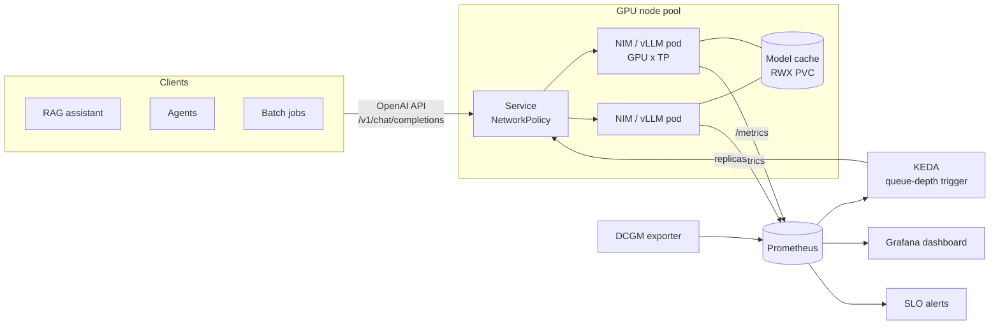
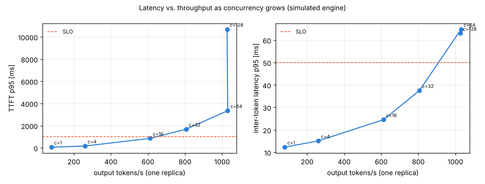

# LLM Inference Platform

[](https://github.com/Isaac19911369/llm-inference-platform/actions/workflows/ci.yml)


This repository is a blueprint for running **self-hosted LLMs on Kubernetes GPUs** (on-premise, HPE or any cloud) as a shared platform service. It covers the full lifecycle:

> **size it** (capacity planner) → **deploy it** (Helm chart for NVIDIA NIM or vLLM) → **load-test it** (OpenAI-compatible benchmark) → **scale it** (KEDA on queue depth) → **operate it** (Grafana dashboard, SLO alerts, runbooks)

All of this sits behind one stable contract, the OpenAI-compatible API. Applications such as the [enterprise-rag-assistant](https://github.com/Isaac19911369/enterprise-rag-assistant) never need to know which engine, GPU or vendor serves a model.

## Architecture



| Component | Path |
|---|---|
| Helm chart (NIM or vLLM, GPU scheduling, model cache, probes, KEDA, ServiceMonitor, PrometheusRule, PDB, NetworkPolicy) | [`charts/llm-inference`](charts/llm-inference) |
| Example values: vLLM on L40S, NIM 70B with TP4 on H100 | [`values-vllm-l40s.yaml`](charts/llm-inference/values-vllm-l40s.yaml), [`values-nim-70b-h100.yaml`](charts/llm-inference/values-nim-70b-h100.yaml) |
| Grafana dashboard (TTFT, ITL, tokens/s, queue, KV cache, GPU from DCGM, replicas) | [`observability/grafana-dashboard.json`](observability/grafana-dashboard.json) |
| Capacity planner, load tester, engine simulator (`llmplat` CLI) | [`src/llmplatform`](src/llmplatform) |
| Architecture decision records | [`docs/adr`](docs/adr) |

## 1. Size it: capacity planning

`llmplat plan` estimates the following before anyone orders GPUs:

- the memory needed for the weights
- the KV cache per token, given grouped-query attention
- how many sequences fit at the planned context length
- a bandwidth-bound decode speed
- the replicas needed for a target load (via Little's law)

```bash
llmplat plan --models llama-3.1-8b llama-3.1-70b --gpus L40S H100-SXM H200 --tp 1 2 4 \
             --context 8192 --rps 2 --output-tokens 300 --target-tps 20
```

Planning scenario: 2 requests/s at peak, 300 output tokens each, at least 20 tokens/s per user, 8k context.

| Model | GPU | TP | Precision | Weights/GPU (GiB) | KV/token (KiB) | Max seqs @ 8k | 1-stream tok/s | Replicas |
|---|---|---|---|---|---|---|---|---|
| Llama 3.1 8B | L4 | 1 | BF16 | 14.96 | 128 | 4 | 11 | too slow |
| Llama 3.1 8B | L4 | 1 | FP8 | 7.48 | 64 | 24 | 22 | 30 |
| Llama 3.1 8B | L40S | 1 | BF16 | 14.96 | 128 | 26 | 32 | 8 |
| Llama 3.1 8B | L40S | 1 | **FP8** | 7.48 | 64 | 67 | 65 | **1** |
| Llama 3.1 8B | H100 SXM | 1 | BF16 | 14.96 | 128 | 55 | 125 | 1 |
| Llama 3.1 70B | L40S | 4 | BF16 | 32.88 | 320 | 13 | 15 | too slow |
| Llama 3.1 70B | H100 SXM | 2 | BF16 | 65.75 | 320 | 3 | 28 | 15 |
| Llama 3.1 70B | H100 SXM | 4 | BF16 | 32.88 | 320 | 59 | 57 | 1 |
| Llama 3.1 70B | H200 | 2 | BF16 | 65.75 | 320 | 47 | 41 | 1 |

**What drives the decision**

- **Decode is memory-bandwidth bound.** Single-stream speed is roughly bandwidth divided by weight bytes. This is why an L4 (300 GB/s) can't serve an 8B model in BF16 at a comfortable reading speed, while an H100 (3.35 TB/s) can.
- **FP8 is the biggest cost lever on L40S-class GPUs.** It halves the weight bytes, doubling decode speed, and FP8 KV cache doubles concurrency. In this scenario that turns 8 L40S replicas into 1. Quality must be checked on your own evaluation set.
- **The KV cache, not the weights, limits 70B on 2×H100.** Only 3 sequences fit at 8k context, so you go to TP4, use an H200 (141 GB), or shorten the context.

These are first-order estimates. The model and its assumptions are documented in [`capacity.py`](src/llmplatform/capacity.py), and they are always validated with a load test.

## 2. Deploy it: Helm chart

```bash
# NVIDIA NIM (needs an NGC API key and registry secret)
kubectl create secret generic llm-credentials --from-literal=NGC_API_KEY=$NGC_API_KEY
helm install llm charts/llm-inference

# open-source vLLM on L40S
helm install llm charts/llm-inference -f charts/llm-inference/values-vllm-l40s.yaml
```

Production details built into the chart:

- **GPU scheduling:** `nvidia.com/gpu` limits, node selector and GPU taint toleration, and `/dev/shm` sized for NCCL with tensor parallelism.
- **Rollouts:** `maxSurge: 1, maxUnavailable: 0` means capacity never drops during a rollout.
- **Probes:** a **startup probe with a 30-minute budget**, because the first start downloads and compiles the model, plus separate readiness and liveness checks on the engine's health endpoints.
- **Shared model cache:** an RWX PVC kept on uninstall ([ADR 0004](docs/adr/0004-shared-model-cache.md)). The chart refuses to render more than one replica on a non-RWX cache.
- **Security:** a NetworkPolicy so that only labelled client pods and Prometheus can reach the server; credentials only from Secrets; non-root pods.

## 3. Load-test it

`llmplat sweep` drives any OpenAI-compatible endpoint (NIM, vLLM, TGI, Azure OpenAI) with streaming requests at increasing concurrency. It measures **time to first token (TTFT)**, **inter-token latency (ITL)**, end-to-end latency and throughput, and picks the highest-throughput point that meets the latency SLO.

```bash
llmplat sweep --url http://llm.inference.svc:8000/v1 --model meta/llama-3.1-8b-instruct \
              --concurrency 1 4 16 32 64 128 --slo-ttft-ms 1000 --slo-itl-ms 50 --plot
```

### Latency vs. throughput

The run below is against the **built-in engine simulator** (`llmplat simulate`), *not a GPU*. The simulator models continuous batching: a fixed number of batch slots, step time growing with batch size, and prefill cost paid when a sequence joins. This lets the tooling, dashboards and autoscaling logic be developed and tested in CI. Prompt: 512 words. Output: 128 ± 50% tokens.

| Concurrency | Req/s | Output tok/s | TTFT p50 / p95 (ms) | ITL p50 / p95 (ms) | E2E p95 (s) |
|---|---|---|---|---|---|
| 1 | 0.60 | 79 | 65 / 66 | 12.3 / 12.3 | 2.3 |
| 4 | 1.94 | 260 | 78 / 169 | 14.4 / 15.1 | 2.8 |
| **16** | **4.68** | **612** | **87 / 859** | **22.3 / 24.5** | **4.7** |
| 32 | 6.17 | 806 | 148 / 1,689 | 31.6 / 37.5 | 7.1 |
| 64 | 7.80 | 1,031 | 222 / 3,352 | 51.0 / 64.8 | 12.1 |
| 128 | 8.08 | 1,027 | 7,765 / 10,688 | 59.2 / 63.1 | 19.2 |



The **shape** of the curve is what matters, and real engines show the same one:

- **Batching is nearly free throughput up to a point.** Going from 1 to 16 concurrent users gives 7.7× more tokens/s, while each user's ITL only doubles.
- **Above the batch capacity (64 slots), throughput is flat and requests only queue.** TTFT explodes from 0.2 s to 7.8 s (p50) with zero extra tokens/s. This is why the autoscaler watches **queue depth**, not GPU utilisation ([ADR 0003](docs/adr/0003-autoscale-on-queue-depth.md)).
- **TTFT p95 at moderate load comes from bursts.** In a closed-loop test all clients start together, so their prompts are prefilled in the same step. Chunked prefill and admission control smooth this out in real engines.
- With SLOs of TTFT p95 ≤ 1 s and ITL p95 ≤ 50 ms, the sweep recommends **concurrency 16 per replica**. That number becomes the autoscaling threshold and the input for `replicas = peak concurrency / 16`.

## 4. Scale it

KEDA scales on `sum(num_requests_waiting)` from Prometheus ([`scaledobject.yaml`](charts/llm-inference/templates/scaledobject.yaml)):

- Scale-up is immediate, one pod per minute.
- Scale-down waits 15 minutes and then removes one pod every 5 minutes, because a GPU pod takes minutes to come back.

## 5. Operate it

- **[Grafana dashboard](observability/grafana-dashboard.json):** TTFT and ITL percentiles, prompt and generation tokens/s, running vs waiting requests, KV-cache usage per pod, GPU utilisation and memory from the DCGM exporter, and replica count. An engine variable switches between NIM and vLLM metric names.
- **[PrometheusRule](charts/llm-inference/templates/prometheusrule.yaml)** with runbook hints:
  - TTFT p95 above the SLO for 10 minutes
  - queue backlog, meaning the autoscaler is at its maximum or GPUs are unavailable
  - KV cache above 95% for 15 minutes

## Design decisions

| ADR | Decision |
|---|---|
| [0001](docs/adr/0001-openai-compatible-api.md) | The OpenAI-compatible API is the platform contract |
| [0002](docs/adr/0002-nim-and-vllm.md) | One chart for NVIDIA NIM and vLLM, and when to choose which |
| [0003](docs/adr/0003-autoscale-on-queue-depth.md) | Autoscale on queue depth, not GPU utilisation |
| [0004](docs/adr/0004-shared-model-cache.md) | Shared persistent model cache for fast, air-gap-friendly cold starts |

## Development

```bash
pip install -e ".[dev,plots]"
pytest                                   # planner math, simulator + load tester, chart checks
llmplat simulate --port 8000 &           # OpenAI-compatible simulator on :8000
llmplat sweep --plot                     # sweep against it
```

CI runs ruff and pytest, then `helm lint` and `helm template` piped into **kubeconform** for every values file. kubeconform validates against the Kubernetes and CRD schemas (KEDA, Prometheus Operator).

## Limitations

- **No GPU benchmark numbers yet.** The planner's efficiency factor and the simulator's performance model are generic. Replace them with sweep results from your own GPUs.
- **Single model per release.** Multi-model routing, LoRA adapters and request priority classes belong in a gateway layer in front of this chart, such as an LLM gateway or Envoy AI Gateway.
- **NIM details vary by model and version.** Metric names and model profiles differ; pin `nimProfile` and verify metrics for the NIM version you deploy.

---

Built by [Dr. Eshagh Dehmollaian](https://github.com/Isaac19911369). This is a public, vendor-neutral write-up of patterns for deploying NVIDIA NIM / Triton-class inference on hybrid cloud and on-premise Kubernetes.
